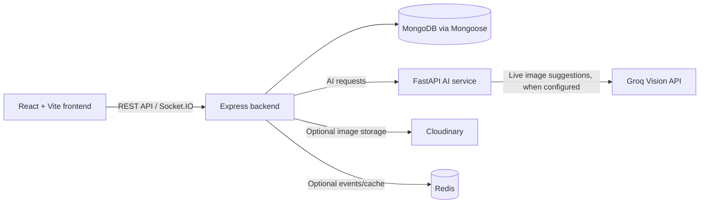

# CampusConnect

CampusConnect is a campus peer-to-peer marketplace. Students can list items to sell, rent, exchange, or give away; browse campus listings; post item requests; and use chat, notifications, rentals, and transactions to complete exchanges.

This repository contains the React frontend, Express/Mongoose backend, and a FastAPI AI service.

## Live deployment

The deployed frontend sign-in page is available at [CampusConnect on Railway](https://campusconnect-frontend-production-78dd975d.up.railway.app/login). The complete application also depends on the availability and configuration of its backend API, MongoDB database, AI service, and image storage.

## Features

- **Accounts and roles:** student registration/login, protected pages, and administrator tools.
- **Marketplace:** create, edit, browse, search, filter, and manage sell, rent, exchange, and giveaway listings.
- **Listing images:** upload, reorder, and remove listing images. Local disk storage is the default; Cloudinary can be enabled with valid credentials.
- **Requests:** students can post item requests and browse other students’ open requests. The matching service checks requests against active listings and sends notifications for likely matches.
- **AI listing suggestions:** propose listing details from an item photo and seller-provided hints. The AI service supports mock mode and live Groq Vision mode.
- **Price estimate:** estimate a suggested range from comparable listings in the same category. The estimate is advisory and can be edited by the seller.
- **Study-material duplicate check:** extract text from uploaded study documents and compare it with existing study-material listings before publishing.
- **Communication and exchange:** chat, wishlist, notifications, rentals, transactions, handover flows, and sustainability pages.
- **Administration:** category management, listing moderation, user administration, disputes, analytics, and audit logs.

## Architecture



The frontend calls the backend API. The backend handles authentication, validation, persistence, image storage, notifications, and calls to the AI service. The AI service exposes its own interactive API documentation at `/docs`.

## Technology

| Area | Technology |
|---|---|
| Frontend | React 18, React Router, Vite, Socket.IO Client |
| Backend | Node.js, Express 5, Mongoose, Socket.IO |
| Database | MongoDB |
| AI service | Python, FastAPI, Pydantic, PyMuPDF/PyPDF, Pillow, Tesseract wrapper |
| Optional integrations | Groq Vision, Cloudinary, Redis |

## Requirements

- Node.js and npm
- Python 3.10 or newer
- MongoDB, either local or MongoDB Atlas
- Tesseract OCR installed on the system for image-based OCR
- Optional: Groq API key for live image suggestions, Cloudinary credentials for cloud image storage, and Redis for event/pub-sub integrations

## Local setup

Run each service in its own terminal from the repository root.

### 1. Configure the backend

```powershell
Copy-Item backend/.env.example backend/.env
cd backend
npm install
npm run dev
```

Update `backend/.env` before running if needed:

- Set `MONGO_URI` to your MongoDB connection string.
- Set a private `JWT_SECRET`.
- Keep `AI_SERVICE_URL=http://localhost:8000` for the local AI service.
- Keep `IMAGE_STORAGE=local` for local disk uploads. To use Cloudinary, set `IMAGE_STORAGE=cloudinary` and provide real `CLOUDINARY_CLOUD_NAME`, `CLOUDINARY_API_KEY`, and `CLOUDINARY_API_SECRET` values.
- Set `CLIENT_URL=http://localhost:3000` for local Socket.IO connections.

The backend listens on `http://localhost:5000`. If the category collection is empty, the backend seeds its default categories when MongoDB connects.

### 2. Configure and start the AI service

```powershell
Copy-Item ai/.env.example ai/.env
cd ai
python -m venv .venv
.\.venv\Scripts\Activate.ps1
pip install -r requirements.txt
uvicorn main:app --reload --port 8000
```

The AI service listens on `http://localhost:8000`:

- Interactive Swagger UI: `http://localhost:8000/docs`
- Health endpoint: `http://localhost:8000/api/v1/health`

For image suggestions, set `GROQ_API_KEY` in `ai/.env` and `AI_MOCK_MODE=false`. To run without a Groq key, set `AI_MOCK_MODE=true`; mock mode is intended for development and does not provide live model output. Pricing, matching, and OCR endpoints are also provided by this service.

### 3. Configure and start the frontend

```powershell
Copy-Item Frontend/.env.example Frontend/.env
cd Frontend
npm install
npm run dev
```

Open `http://localhost:3000`. The Vite development server proxies `/api` and `/uploads` to the backend on port `5000`.

## Main API routes

Marketplace routes use `http://localhost:5000/api/v1`. Authentication is mounted at `/api/auth`, and rental requests are mounted at `/api/rental-requests`.

| Method | Route | Purpose |
|---|---|---|
| `POST` | `/api/auth/register`, `/api/auth/login` | Create an account and authenticate |
| `GET` | `/api/v1/categories` | Read active listing categories |
| `GET`, `POST` | `/api/v1/listings` | Browse and create listings |
| `GET` | `/api/v1/listings/mine` | Read the signed-in user's listings |
| `POST` | `/api/v1/listings/ai-suggest` | Request AI listing suggestions from an image |
| `POST` | `/api/v1/listings/price-estimate` | Estimate a listing price from comparable listings |
| `POST` | `/api/v1/listings/ocr-check` | Extract and compare study-material text |
| `POST` | `/api/v1/listings/{id}/matches` | Match a listing against open campus requests |
| `POST` | `/api/v1/listings/{id}/images` | Upload listing images |
| `POST`, `GET` | `/api/rental-requests` | Create a request or browse open requests |
| `GET` | `/api/rental-requests/my` | Read the signed-in user's requests |
| `GET` | `/api/v1/notifications` | Read notifications, including match notifications |

Routes requiring a signed-in user expect the bearer token used by the application. See [the OpenAPI specification](Docs/system-design/CampusConnect_openapi.yaml) for additional route details. The FastAPI service has its own Swagger UI at `/docs`.

## Data and integration

MongoDB documents are managed with Mongoose. Core collections include users, categories, listings, rental requests, rentals, transactions, notifications, chat threads/messages, and match records. A listing references its owner and category; a request belongs to its requester. The backend stores extracted study-document text on eligible listings for future duplicate comparisons.

Images are uploaded through the backend. In local mode, the backend writes image variants under `backend/uploads/` and serves them from `/uploads`. In Cloudinary mode, the backend stores Cloudinary URLs and public IDs with the listing. The selected provider is controlled by `IMAGE_STORAGE` in `backend/.env`.

## AI workflows

1. **Price estimate:** the backend supplies recent active comparable listings from the same category. The AI service filters outliers and returns a suggested range; the student chooses the final price.
2. **Request matching:** when a listing becomes visible, the AI service compares its title, description, category, and price with open requests. When a request is posted, recent active listings are also checked. Likely matches are stored and the requester is notified.
3. **OCR duplicate check:** the backend accepts a PDF or supported image, forwards it for text extraction, and compares the text with existing study-material text. The app warns or blocks publishing when the similarity crosses the configured threshold.
4. **Listing suggestions:** the AI service can infer a title, description, category, condition, and tags from an image and seller hints. Live vision suggestions require Groq credentials; mock mode is useful for local integration work.

AI output is a suggestion. Students should review listing details and pricing before publishing.

## Verification

Run the checks from their respective directories:

```powershell
# Backend tests
cd backend
npm test

# AI service tests
cd ../ai
python -m unittest test_ai_service.py

# Frontend production build
cd ../Frontend
npm run build
```

For a manual demo, sign in as a student and try creating a listing, generating a price estimate, checking a study document, and posting a request. Publish or approve a listing that resembles the request, then verify the match notification. Add screenshots of these flows and successful API responses to the course submission if evidence is required.

## Configuration and limitations

- Never commit `.env` files, API keys, database credentials, JWT secrets, or Cloudinary secrets. The checked-in `.env.example` files contain placeholders only.
- Cloudinary is not active with placeholder credentials. Configure real credentials and `IMAGE_STORAGE=cloudinary` before describing cloud uploads as verified.
- Live Groq image suggestions require a valid `GROQ_API_KEY`. Mock mode does not validate production model behavior.
- Matching and OCR quality depends on the request/listing text, document quality, corpus size, and AI service configuration.
- Redis is optional for the base local workflow.

## Repository map

```text
CampusConnect/
├── Frontend/       React application
├── backend/        Express API, Mongoose models, and storage adapters
├── ai/             FastAPI AI service
└── Docs/           API specification and module documentation
```

See [AI service documentation](ai/README.md), [marketplace documentation](Docs/marketplace/README.md), and [OpenAPI specification](Docs/system-design/CampusConnect_openapi.yaml) for module-level details.
