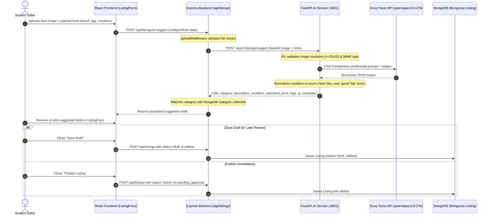
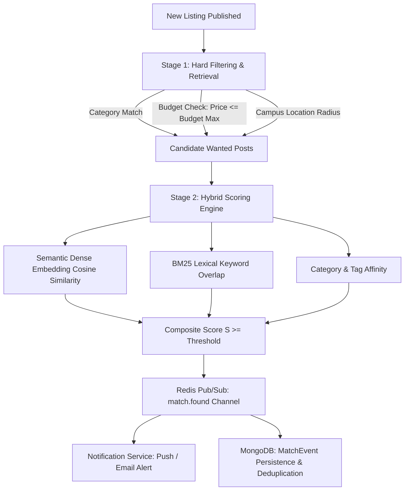

# CampusConnect AI Services Module: Technical Architecture, Research & Planning

**Module Owner:** Heer (AI Services Lead)  
**Project:** CampusConnect — University Marketplace & Resource Exchange  
**Evaluation Stage:** Mid-Project Evaluation  
**Status:** Core Vision Generation Implemented & Live; Advanced Engines Researched & Planned  

---

## 1. Executive Summary & Scope

The **AI Services Module** is responsible for automating, accelerating, and securing listing creation and discovery across CampusConnect. During the first phase of development leading up to the **Mid-Project Evaluation**, the module has successfully delivered:

1. **AI-Powered Listing Generation:** A high-throughput, low-latency microservice built with **FastAPI** integrated with **Groq's Vision API** (using `qwen/qwen3.8-27b`), capable of analyzing an uploaded item photograph alongside optional seller hints (Brand/Name, Age/Usage, Seller Condition) to draft listing titles, categories, descriptions, condition assessments, tags, and price estimates.
2. **MongoDB / Mongoose Schema Integration:** Seamlessly integrated with the Express backend and React frontend, populating Mongoose `Listing` records with `aiMeta` metadata while maintaining student review, draft saving (`status: 'draft'`), and editing workflows before publishing.
3. **Robust Input Validation & Error Handling:** Comprehensive request sanitation, supporting image format enforcement (JPEG/PNG/WebP), size bounds (1 byte to 10 MB), minimum resolution verification ($\ge 32\times 32$ pixels), fallback mock mechanisms, and precise HTTP error semantics (400, 413, 415, 422, 503).
4. **Architectural Blueprints & Research:** Comprehensive algorithmic planning and mathematical formulations for **Price Estimation**, **Intelligent Listing Matching**, and **OCR-Based Duplicate Detection**.

---

## 2. AI-Powered Listing Generation: Architecture & Implementation

### 2.1 System Architecture & Data Flow



### 2.2 Input Validation Specifications

- **MIME Type Enforcement:** Restricted strictly to `image/jpeg`, `image/png`, and `image/webp`. Unsupported types return `HTTP 415 Unsupported Media Type`.
- **Payload Size Limits:** Max 10 MB upload buffer. Over-sized files return `HTTP 413 Payload Too Large`.
- **Dimension Check:** Vision models reject sub-resolution or corrupt files. Images are validated through PIL to guarantee dimensions are at least $32 \times 32$ pixels; sub-resolution images return `HTTP 422 Unprocessable Entity`.
- **Input String Bounds:** Optional seller hints (`name_or_brand` $\le 120$ chars, `age` $\le 80$ chars, `condition` $\le 50$ chars, `description` $\le 1000$ chars) prevent prompt injection and buffer overflow.

### 2.3 Condition Normalization & Schema Conformance

The Express MongoDB schema defines the `condition` enum strictly as:
`['new', 'like_new', 'good', 'fair', 'poor']`

The AI service maps raw model outputs and user inputs through a canonical normalization dictionary:
```python
CONDITION_NORMALIZATION_MAP = {
    "new": "new", "brand new": "new",
    "like new": "like_new", "like_new": "like_new", "likenew": "like_new",
    "good": "good",
    "fair": "fair", "acceptable": "fair",
    "poor": "poor", "heavily used": "poor",
}
```
Both the canonical database key (`condition`) and a user-friendly UI label (`condition_display`, e.g., `"Like New"`) are returned.

### 2.4 MongoDB/Mongoose Integration & Draft Review Workflow

The Mongoose `Listing` schema stores AI lineage without requiring migrations:
```javascript
aiMeta: {
  type: mongoose.Schema.Types.Mixed,
}
```
When an AI listing is drafted:
- The user reviews title, description, category, and price in `ListingForm.jsx`.
- If saved as a draft, `status: 'draft'` is preserved by the controller (`createListing`), allowing users to retrieve and review their saved drafts via `GET /api/listings/mine?status=draft` or `GET /api/listings/mine?isAiGenerated=true`.
- The listing maintains full provenance: model name, timestamp, and source (`groq` or `mock`).

---

## 3. Research & Engineering Plan: Price Estimation Engine

### 3.1 Campus Micro-Economic Dynamics

University marketplaces exhibit unique pricing patterns compared to general consumer e-commerce:
1. **Semester Cyclicality:** Peak textbook and hostel supply occurs at term end; peak demand occurs during the first two weeks of classes.
2. **Standardized Course Catalogs:** Multiple students sell identical items (e.g., *Boylestad Circuit Analysis*, Casio FX-991EX calculators, lab aprons) across cohorts.
3. **Accelerated Wear:** Academic items experience heavy mechanical wear over short durations.

### 3.2 Implemented Baseline: IQR-Filtered, Condition-Adjusted Category Median

The FastAPI endpoint (`POST /api/v1/pricing/estimate`) accepts same-category campus comparables. The Express backend route (`POST /api/v1/listings/price-estimate`) gathers up to 100 recent active or approved sell listings in the selected category, excludes the requesting user's listings, and forwards their prices to the AI service.

The estimator uses a robust non-parametric baseline:
- Filters outliers with Tukey's 1.5 × IQR fences when at least four comparable prices are available; smaller samples are retained because quartile-based outlier detection is unreliable with very few records.
- Computes the median asking price of the retained comparables, $M = \text{median}(\{P_1, P_2, \dots, P_k\})$.
- Applies a condition-based depreciation scalar $D_c$:
  $$D_{new} = 1.00,\quad D_{like\_new} = 0.90,\quad D_{good} = 0.75,\quad D_{fair} = 0.55,\quad D_{poor} = 0.35$$
- Computes estimated price $\hat{P} = \text{round}\left(M \times \frac{D_c}{0.75}, 2\right)$. The displayed price band uses the first and third quartiles of retained comparables, adjusted by the same condition scalar; the API reports submitted, retained, and excluded comparable counts.
- If no comparables are present, it returns an explicit `insufficient_comparables` code, avoiding false price hallucinations.

### 3.3 Final Project Phase: Machine Learning Price Regression

For the final evaluation, the price estimation engine will transition to an **XGBoost / LightGBM** regression model:

#### Feature Representation:
$$\mathbf{x} = \left[ \mathbf{e}_{title},\, C_{cat},\, \text{age\_months},\, \text{condition\_scalar},\, \text{original\_mrp},\, \text{term\_seasonality\_index} \right]$$
- $\mathbf{e}_{title} \in \mathbb{R}^{384}$: Dense embedding of item title generated via sentence transformers.
- $\text{term\_seasonality\_index} \in [0, 1]$: Gaussian proximity function to semester commencement dates.
- $\text{condition\_scalar} \in \{1, 2, 3, 4, 5\}$.

#### Training Objective:
$$\mathcal{L}_{price}(\theta) = \frac{1}{N} \sum_{i=1}^N \left| \frac{y_i - \hat{y}_i(\theta)}{y_i} \right| \quad (\text{Mean Absolute Percentage Error - MAPE})$$
Target accuracy: $\text{MAPE} \le 12.5\%$ across standard campus categories.

---

## 4. Research & Engineering Plan: Intelligent Listing Matching

### 4.1 Problem Definition

When a student lists an item for sale or rent, CampusConnect must automatically identify and notify students who published relevant "Wanted Posts" (buyer requests), maximizing liquidation speed and student convenience.

### 4.2 Two-Stage Matching Architecture



### 4.3 Composite Similarity Formulation

For listing $L$ and wanted post $W$:
$$S(L, W) = w_1 \cdot \cos(\mathbf{e}_L, \mathbf{e}_W) + w_2 \cdot \text{BM25}(L_{text}, W_{text}) + w_3 \cdot \mathbb{I}(Cat_L = Cat_W) - w_4 \cdot \Delta_{budget}$$
Where:
- $\Delta_{budget} = \max\left(0, \frac{Price_L - Budget_W}{Budget_W}\right)$ penalizes listings that exceed the student's declared budget.
- Threshold $\tau = 0.65$ triggers notification events.
- Redis publishes: `{"event": "match.found", "data": {"wanted_post_id": "...", "user_id": "...", "listing_id": "...", "similarity_score": 0.88}}`.

---

## 5. Research & Engineering Plan: OCR-Based Duplicate Detection

### 5.1 Problem Definition

Students frequently upload duplicate or plagiarized course notes, question banks, and solution manuals. Duplicate detection ensures content originality, saves storage, and prevents spam.

### 5.2 Document Processing Pipeline

1. **Native Text PDF Extraction:** Fast direct stream parsing using `pypdf`.
2. **Scanned PDF / Image Rasterization:** Page-by-page rendering via `PyMuPDF` (`fitz`) at 180 DPI $\rightarrow$ OCR extraction via `pytesseract` (or Groq Vision document analysis).
3. **Text Normalization:** Lowercasing, punctuation stripping, stopword elimination, and regex whitespace collapse.

### 5.3 Scalable Deduplication Algorithm (MinHash + LSH)

For large corpora, comparing new documents pairwise with all historical documents ($O(N)$) is prohibitive.
We employ **Locality Sensitive Hashing (LSH)** with **MinHash signatures**:

1. **$k$-Shingling:** Convert document text into overlapping token sequences of length $k=5$:
   $$S(D) = \{ \text{"computer networks unit 3 osi"}, \text{"networks unit 3 osi model"}, \dots \}$$
2. **MinHash Signatures:** Apply $m=128$ independent universal hash functions $h_i(s)$ to find the minimum hash per shingle set:
   $$h_{min, i}(D) = \min_{s \in S(D)} h_i(s)$$
3. **LSH Banding:** Partition signature matrix into $b=16$ bands of $r=8$ rows. Any collision in a single band yields a candidate pair in $O(1)$ time.
4. **Verification:** Evaluate SequenceMatcher ratio $\rho$ for candidates:
   - $\rho \ge 0.82$: Flag as **Definite Duplicate** (block submission / notify student).
   - $0.60 \le \rho < 0.82$: Flag as **Partial Variant / Revision** (link to existing resource).

---

## 6. Verification & Automated Test Results

The AI module is accompanied by automated test suites in Python (FastAPI unit/integration) and JavaScript (Node.js/Mongoose):

### Test Execution Summary

| Test Suite | Environment | Tests | Passed | Failed | Status |
| :--- | :--- | :---: | :---: | :---: | :---: |
| `ai/test_ai_service.py` | Python 3.14 / pytest & unittest | 13 | 13 | 0 | **PASS** |
| `backend/src/tests/*.test.js` | Node.js v20+ / node:test | 10 | 10 | 0 | **PASS** |
| `Frontend` build verification | Vite 6.4.4 / Production build | 35 modules | 35 | 0 | **PASS** |

### Verified Test Cases:
- `test_health_check`: Validates `/api/v1/health` reports status, mode, and vision model.
- `test_condition_normalization`: Verifies all condition synonyms map to Mongoose enum values.
- `test_clean_json_response`: Verifies resilient parsing of LLM responses wrapped in markdown fences.
- `test_image_validation_min_resolution`: Verifies sub-32px images trigger HTTP 422.
- `test_suggest_missing_image_returns_422`: Validates missing payload error.
- `test_suggest_unsupported_content_type_returns_415`: Validates MIME rejection.
- `test_suggest_with_brand_age_condition_hints`: Validates end-to-end prompt enhancement with seller hints.
- `test_multipart_upload_suggest`: Tests direct multipart image and form field upload.
- `test_price_estimation_with_comparables`: Validates median and condition calculation.
- `test_price_estimation_insufficient_comparables`: Validates safe fallback response.
- `test_wanted_post_matching`: Validates ranking and budget discount.
- `test_ocr_duplicate_detection`: Validates sequence matcher duplicate identification.
- `Listing Model Integration`: Confirms Mongoose schema instantiates and saves `aiMeta` and `draft` status.
